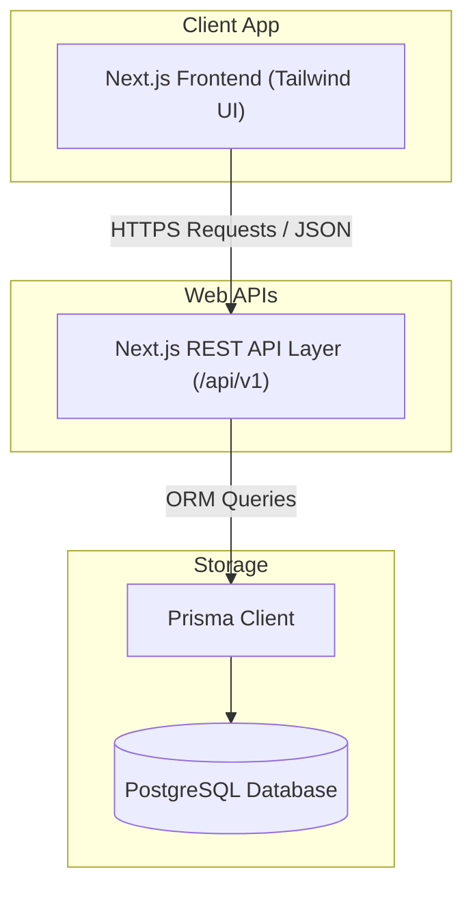
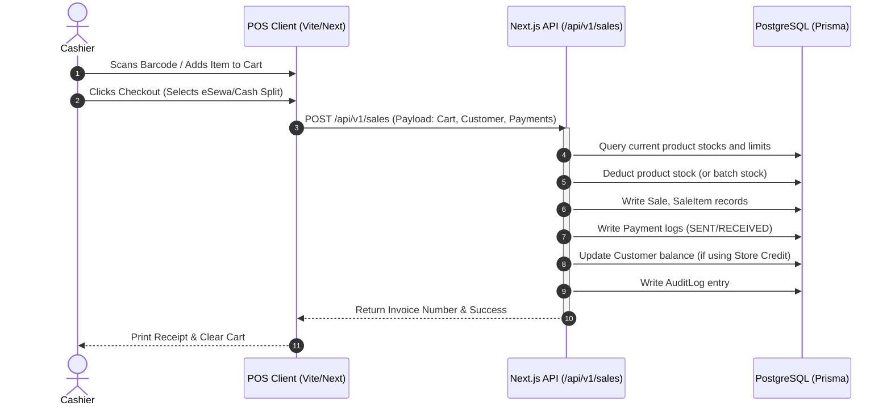
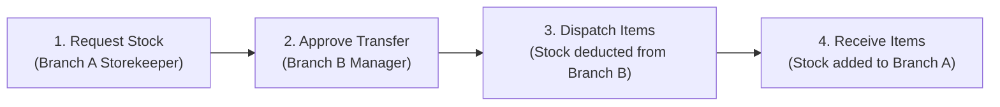
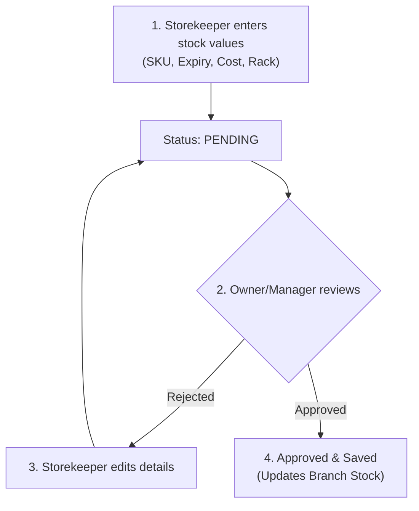

# Prayassh POS & ERP — Complete System Overview and Features Catalog

Welcome to the **Prayassh** POS & ERP platform. This document provides a high-level system overview, details the monorepo architecture, explains the Role-Based Access Control (RBAC) rules, catalogues all features across the core business modules, and maps out critical business workflow lifecycles.

---

## 1. System Architecture Overview

Prayassh is designed as a **multi-tenant Software-as-a-Service (SaaS)** system using a modern, scalable, and type-safe monorepo architecture. 

### 1.1 Technical Stack
* **Front-End Platform**: Built with React and Next.js (App Router) using Tailwind CSS for UI layouts and responsiveness. Accessible at [frontend/src/app](file:///c:/Users/ACER/OneDrive/Desktop/dynapos/frontend/src/app).
* **Back-End REST APIs**: Developed using Next.js route handlers acting as serverless/edge APIs. Mounted under [backend/src/app/api/v1](file:///c:/Users/ACER/OneDrive/Desktop/dynapos/backend/src/app/api/v1).
* **Database Layer**: PostgreSQL database managed via Prisma ORM for schema migration and query generation. The schema is specified at [packages/db/prisma/schema.prisma](file:///c:/Users/ACER/OneDrive/Desktop/dynapos/packages/db/prisma/schema.prisma).
* **Authentication**: Token-based JSON Web Tokens (JWT) handling device verification, secure routing, and context isolation.

### 1.2 Repository Structure (Monorepo)
The workspace follows a clean monorepo layout split into packages and applications:
* `/frontend`: Interactive dashboard UI, POS screen, settings, and analytical reports.
* `/backend`: RESTful APIs, validation schemas using Zod, and middleware logic.
* `/packages/db`: Contains the database setup, migrations, and generated Prisma client files.

---

## 2. Multi-Tenant and Data Isolation Model

The platform uses a strict multi-tenant model based on `businessId` tracking across all entities.

* **Tenant Isolation**: Every transaction, product, customer, supplier, ledger, and configuration is tagged with a `businessId`. There is no data leakage across tenants; a business cannot access or edit other businesses' data.
* **Location (Branch/Warehouse) Hierarchy**: Each business contains one or more `Branch` entries. Users are assigned to branches, and stock levels are tracked locally per branch using the `ProductStock` table.
* **Super Admin Control**: A specialized global dashboard manages onboarding, approvals, monitoring, and global settings.

---

## 3. Role-Based Access Control (RBAC)

Prayassh enforces robust role-based constraints. Roles are verified by server middleware and client routing to isolate permissions:

| Role | Target Scope | Key Permissions & Constraints |
| :--- | :--- | :--- |
| **SUPER_ADMIN** | Global System | Approves business registrations, adjusts global subscription limits, monitors revenue. |
| **OWNER** | Entire Tenant | Full tenant access: subscription upgrades, branch setup, financial books, configuration, full audits. |
| **MANAGER** | Assigned Branch | Manages branch inventory, sales, purchases, contacts. Cannot edit core subscription tiers. |
| **CASHIER** | Assigned Branch | Direct POS checkout, prints receipts, views personal sales histories only. Cannot perform manual inventory adjustments. |
| **ACCOUNTANT** | Assigned Branch | Financial ledger reviews, expense categories, vouchers, tax analysis. Cannot modify product stock catalogs. |
| **STOREKEEPER**| Assigned Branch | Handles inventory adjustments, batching, stock movements, and branch transfers. |
| **SALESPERSON**| Assigned Branch | Create orders, register customer details, draft sales. |
| **DELIVERY** | Assigned Branch | Views order destination cards, tracks delivery fulfillment state. |

---

## 4. Comprehensive Features Catalog

### 4.1 SaaS Onboarding & Subscription Lifecycle
* **Registration Pipeline**: Prospects submit sign-up requests tracking business specs, currency, and billing duration. Handled via the `BusinessRegistrationRequest` model.
* **Admin Review Queue**: Super admins review pending requests, request updates, reject with reasons, or approve. Approval automatically sets up the tenant space, owner profile, and database seed.
* **Subscription Management**: Tracks user counts, branch count limits, and license expiration periods.

### 4.2 Core Inventory & Taxonomy
* **Product Catalog**: Manage core parameters including SKU, barcode, unit classification, cost/selling price, wholesaler rates, VAT-taxable toggles, and image logs.
* **Hierarchy**: Multi-level classification using Categories, Subcategories, Brands, and Units.
* **Low Stock Alerts**: Automatically triggers alarms on the dashboard when a product's current stock falls below its custom alert quantity.

### 4.3 Advanced Batch & Expiry Management
* **Batch Triggers**: Toggles batch tracking per product.
* **Expiry Tracking**: Track manufacturing and expiration timelines per batch.
* **Rack Location Mapping**: Map batches to specific physical racks in a warehouse (e.g. "Rack B-4") for fast warehouse dispatching.
* **Batch Pricing**: Assign batch-specific cost prices and selling rates to handle fluctuating market costs.

### 4.4 Stock Management & Movements
* **Opening Stock**: Initializes inventory records. Requires a double-entry approval workflow (Storekeeper entries can require Manager/Owner approval to register).
* **Manual Stock Adjustments**: Multi-level stock corrections (increases/decreases) with audit trails detailing correction reasons. Restricted from Cashiers. See [adjust/route.ts](file:///c:/Users/ACER/OneDrive/Desktop/dynapos/backend/src/app/api/v1/products/%5Bid%5D/adjust/route.ts).
* **Branch Stock Transfers**: Formal workflow to move products safely between physical branches:
  * *Request*: Branch asks for products.
  * *Approval*: Dispatching branch verifies stock availability.
  * *Dispatch*: Quantities are deducted from the source.
  * *Receipt*: Target branch confirms receipt and adds items to local stock.

### 4.5 Point of Sale (POS) & Checkout Engine
* **Interactive Cashier Workspace**: Interactive POS terminal supporting category searches, barcode scans, card readers, and layout cache storage.
* **Transaction Invoices**: Computes totals, taxes (VAT config), discounts (cart-level and line-level), and notes. Registers invoice records instantly.
* **Nepal-Focused Split Payment Modes**: Accepts multiple split payment configurations, integrating Nepal-specific gateways (eSewa, Khalti, FonePay, NepalPay) alongside Cash, Card, Bank, and Store Credit.
* **Sale Returns**: Reverse whole or partial sales, registering return logs and returning items to active stock.

### 4.6 Purchasing & Supplier Logins
* **Purchase Orders**: Log item intakes from vendors. Automatically updates product stock, updates batch profiles, and logs accounts payable.
* **Purchase Returns**: Logs items sent back to suppliers due to damage or expiration. Adjusts outstanding accounts payable.

### 4.7 Accounting Ledgers & Dues
* **Accounts Receivable**: Tracks customer types (Retail/Wholesale), custom credit limits, and running balances.
* **Accounts Payable**: Manages supplier outstanding payments.
* **Double-Entry Ledgers**: Logs detailed `CustomerLedger` and `SupplierLedger` histories documenting sales, purchases, payments, returns, and adjustments.
* **Consolidated Cash Book**: Monitors cash receipts (`RECEIVED`) and payouts (`SENT`) by payment method, cashier, and branch.

### 4.8 Expenses & Income Register
* **Voucher Records**: Formally register utility payouts, salaries, rent, or logistics expenses.
* **Taxonomy**: Categorize payouts using custom expense/income categories to compile exact profit margins.

### 4.9 System Audits & Real-Time Alerts
* **Consolidated Audit logs**: Captures detailed action, module type, IP address, device fingerprints, and `oldValue`/`newValue` JSON structures for maximum compliance.
* **Real-time Notifications**: Alarms cashiers on low stock, notifies storekeepers of new transfers, and alerts admins of licensing notifications.

---

## 5. Core Business Workflows

### 5.1 Point of Sale Checkout Workflow

### 5.2 Branch Stock Transfer Workflow

### 5.3 Opening Stock Flow

---

## 6. Verification and Maintenance

This documentation can be validated by checking the following source files:
* Database schema details: [packages/db/prisma/schema.prisma](file:///c:/Users/ACER/OneDrive/Desktop/dynapos/packages/db/prisma/schema.prisma)
* Active REST API endpoints: [backend/src/app/api/v1](file:///c:/Users/ACER/OneDrive/Desktop/dynapos/backend/src/app/api/v1)
* Cashier routes and split payment modes: [backend/src/app/api/v1/sales/route.ts](file:///c:/Users/ACER/OneDrive/Desktop/dynapos/backend/src/app/api/v1/sales/route.ts)
* System Deployment configuration guides: [Prayassh_System_Architecture.md](file:///c:/Users/ACER/OneDrive/Desktop/dynapos/Prayassh_System_Architecture.md)
