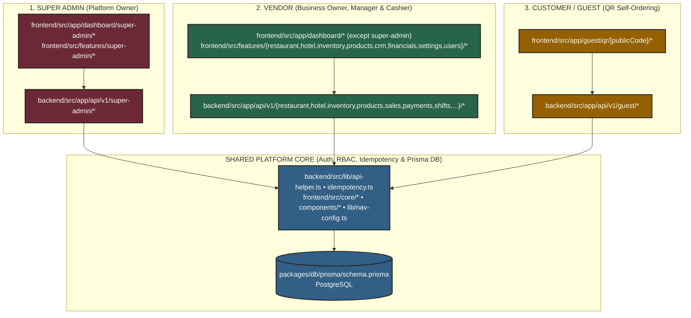
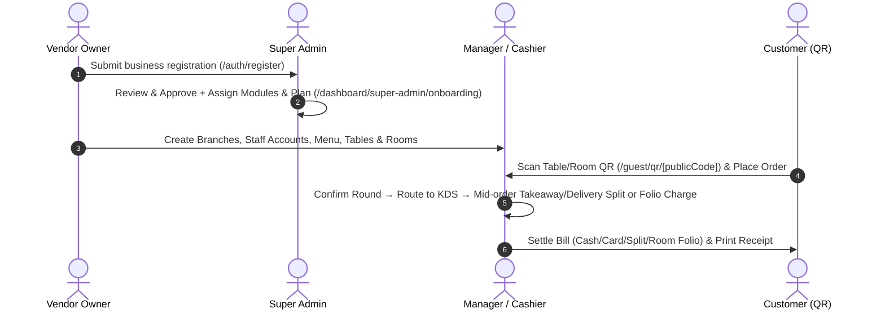

<div align="center">

# 🏛️ RestroInn — Hospitality, Restaurant POS & Multi-Tenant SaaS Suite

**Enterprise-grade Hotel PMS, Restaurant POS & KDS, Inventory, Accounting & QR Self-Ordering Platform**

[](https://nextjs.org/)
[](https://expressjs.com/)
[](https://www.prisma.io/)
[](https://www.typescriptlang.org/)
[](https://vitest.dev/)

<p>
  <a href="#-user-tier-code-separation">User-Separated Code Map</a> •
  <a href="#-system-architecture">Architecture</a> •
  <a href="#-core-workflows">Workflows</a> •
  <a href="#-folder-structure">Folder Structure</a> •
  <a href="#-security--rbac-matrix">Security & RBAC</a> •
  <a href="#-getting-started">Getting Started</a>
</p>

</div>

---

## 🎯 What Is RestroInn?

**RestroInn** is a full-stack, multi-tenant hospitality and retail operations platform built for **restaurants, cafes, hotels, resorts, and multi-branch businesses**. It unifies:

- **Platform Governance (Super Admin):** Tenant onboarding approvals, SaaS subscription plans, module entitlement toggles, revenue analytics, and cross-tenant audit/support tooling.
- **Business Operations (Vendor — Owner, Manager & Cashier):** Restaurant POS (with split rounds, mid-order **Dine-In → Takeaway / Delivery** fulfillment transitions, KDS kitchen routing, table/cabin management), Hotel PMS (reservations, check-in/out, guest folios, housekeeping, night audit), Inventory & Recipe BOM, Accounting/IRD compliance, and Shift Registers.
- **Self-Service Ordering (Customer / Guest):** Frictionless QR table/room scanning, OTP/session join, live shared cart, kitchen status tracking, and server turnover alerts.

---

## 👥 User-Tier Code Separation

To eliminate confusion for developers, the codebase is organized into **three clear user tiers** plus a **shared core**. Deep-dive developer guides for each tier live in [`docs/architecture/`](docs/architecture/).



### Quick Navigation by User Role

| Tier | Roles | Primary Responsibility | Frontend Code | Backend APIs | Detailed Guide |
| :--- | :--- | :--- | :--- | :--- | :--- |
| **1. Super Admin** | `SUPER_ADMIN` | Approve registrations, manage businesses, plans, modules, platform revenue, logs & support | `frontend/src/app/dashboard/super-admin/`<br>`frontend/src/features/super-admin/` | `backend/src/app/api/v1/super-admin/` | [`SUPER_ADMIN.md`](docs/architecture/SUPER_ADMIN.md) |
| **2. Vendor Admin & Staff** | `OWNER`, `MANAGER`, `CASHIER` | Run Restaurant POS, KDS, Hotel PMS, Folios, Inventory, Shifts, CRM & Financials | `frontend/src/app/dashboard/` *(non-super-admin)*<br>`frontend/src/features/` | `backend/src/app/api/v1/{restaurant,hotel,inventory,sales,payments,...}/` | [`VENDOR.md`](docs/architecture/VENDOR.md) |
| **3. Customer / Guest** | `GUEST` *(QR Session)* | Scan QR, join table/room, browse menu, place self-orders, request service & view bill | `frontend/src/app/guest/qr/[publicCode]/` | `backend/src/app/api/v1/guest/` | [`CUSTOMER_GUEST.md`](docs/architecture/CUSTOMER_GUEST.md) |

> [!TIP]
> **Vendor Sub-Role Distinction:** Within a tenant business, `OWNER` and `MANAGER` hold administrative privileges (menu/room setup, inventory adjustments, user/branch management, order/line cancellations, reversals), while `CASHIER` handles daily POS billing, shifts, KDS updates, check-ins, and payment collection.

---

## 🏗️ System Architecture

RestroInn follows a **clean monorepo separation** between presentation (`frontend`), API & domain services (`backend`), and database schema (`packages/db`).

```mermaid
flowchart LR
    classDef client fill:#F7F3EC,stroke:#6B2837,color:#292320,stroke-width:2px
    classDef api fill:#EEE7DD,stroke:#28634B,color:#292320,stroke-width:2px
    classDef data fill:#292320,stroke:#946000,color:#FFFCF7,stroke-width:2px

    subgraph FE["Frontend — Next.js 16 (Port 3000)"]
        Pages["App Router Pages<br/>(super-admin / dashboard / guest)"]:::client
        Stores["Zustand Stores & Hooks<br/>(pos-cart, pos-tickets, kds, hotel)"]:::client
        Repo["Core API Client<br/>(api-client.ts + idempotent-request.ts)"]:::client
        Pages --> Stores --> Repo
    end

    subgraph BE["Backend — Express 5 (Port 4000)"]
        Guard["RBAC & Tenant Guard<br/>(requireRole + businessId isolation)"]:::api
        Idem["Idempotency Layer<br/>(x-idempotency-key)"]:::api
        Routes["REST v1 Route Handlers<br/>(/api/v1/*)"]:::api
        Services["Domain Services<br/>(POS, KDS, Folio, Inventory, IRD)"]:::api
        Guard --> Idem --> Routes --> Services
    end

    subgraph DB["Data Layer"]
        Prisma["Prisma Client<br/>(packages/db)"]:::data
        PG[("PostgreSQL")]:::data
        Prisma --> PG
    end

    Repo -- "REST + JWT Session + Idempotency Key" --> Guard
    Services --> Prisma
```



### Key Architectural Principles
1. **Clean Feature Modules (`frontend/src/features/<domain>/`):**
   - `models/` — Domain TypeScript interfaces & constants
   - `state/` — Zustand state stores (`pos-cart.store.ts`, `pos-tickets.store.ts`, `hotel-folios.store.ts`, etc.)
   - `repositories/` — Typed API adapters calling `apiClient`
   - `presentation/` — Containers, components, and dialogs (strictly adhering to RestroInn flat design tokens)
2. **Backend Security & Safety (`backend/src/lib/`):**
   - `requireRole(req, roles)` enforces role-based access and tenant (`businessId`) scoping on every mutating route.
   - `idempotency.ts` prevents duplicate charges, double stock deductions, or duplicate order rounds on flaky POS networks.
   - Sanitized error responses (`apiError` / `handleApiError`) prevent leaking internal stack traces or Prisma internals to clients.
3. **Design System Consistency (`uiuxskills.md`):**
   - Flat, warm hospitality palette: **Deep Burgundy** (`#6B2837`), **Warm Ivory** (`#F7F3EC`), **Porcelain** (`#FFFCF7`), **Espresso** (`#292320`), **Forest Green** (`#28634B`), **Amber** (`#946000`).
   - Crisp `1px` borders (`#D8CEC1`), `tabular-nums` on all prices/totals, zero heavy drop shadows or glassmorphism.

---

## 🔄 Core Workflows

### 1. Platform Onboarding → Daily Operations


### 2. Restaurant POS — Dine-In, Partial Takeaway/Delivery & Cancellation Flow
- **Multi-Round Ordering:** Draft items are confirmed into numbered kitchen rounds (`Round #1`, `Round #2`) and routed to KDS stations.
- **Mid-Order Fulfillment Change:** On an active Dine-In order, staff can open `LineAdjustmentModal` to convert **all or a partial quantity** of any line item from `DINE_IN` to `TAKEAWAY` or `DELIVERY` (recording packaging/delivery notes and updating kitchen/bill state without cancelling the table).
- **Cancellation Policy:** `CancelOrderModal` & `KdsCancelModal` enforce reason tracking and role checks for voiding draft/submitted lines or full orders.

---

## 📁 Folder Structure

```text
pos/
├── frontend/                         # Next.js 16 App Router UI (Port 3000)
│   └── src/
│       ├── app/
│       │   ├── auth/                 # Shared Login, Registration & Status Pages
│       │   ├── dashboard/
│       │   │   ├── super-admin/      # [TIER 1] Super Admin Pages
│       │   │   └── ...               # [TIER 2] Vendor Pages (POS, Hotel, Inventory, Reports)
│       │   └── guest/qr/[publicCode]/# [TIER 3] Customer QR Self-Ordering App
│       ├── features/
│       │   ├── super-admin/          # [TIER 1] Super Admin UI Modules
│       │   ├── restaurant/           # [TIER 2] POS, KDS, Menu, Tables, QR
│       │   ├── hotel/                # [TIER 2] Rooms, Stays, Folios, Housekeeping
│       │   ├── inventory/            # [TIER 2] Stock, Adjustments, Batches, Transfers
│       │   ├── products/             # [TIER 2] Catalog & Recipe BOM
│       │   ├── crm/                  # [TIER 2] Customers & Suppliers
│       │   ├── financials/           # [TIER 2] Expenses, Payments, Purchases
│       │   └── settings/             # [TIER 2] Branches, Registers, Tax/IRD
│       ├── components/               # Shared Shell, Modals, Export & Table Controls
│       ├── core/api/                 # Unified API Client
│       ├── hooks/                    # Shared Client Hooks
│       └── lib/                      # Navigation Config, Currency & Helpers
│
├── backend/                          # Express 5 REST API (Port 4000)
│   └── src/
│       ├── app/api/v1/
│       │   ├── super-admin/          # [TIER 1] Platform Admin Endpoints
│       │   ├── guest/                # [TIER 3] Guest QR Session & Self-Order Endpoints
│       │   ├── restaurant/           # [TIER 2] Orders, Rounds, KDS, Tables, Menu
│       │   ├── hotel/                # [TIER 2] Stays, Folios, Rooms, Housekeeping
│       │   ├── inventory/            # [TIER 2] Stock Movements, Transfers, Opening
│       │   ├── auth/                 # Shared Authentication & Registration
│       │   └── ...                   # Sales, Payments, Purchases, Reports, Compliance
│       ├── lib/                      # RBAC (`api-helper.ts`), Idempotency, Validation
│       └── services/                 # Business Logic Services
│
├── packages/
│   └── db/                           # Shared Prisma Schema & Client (`schema.prisma`)
├── docs/
│   └── architecture/                 # Role-Separated Developer Guides
│       ├── SUPER_ADMIN.md
│       ├── VENDOR.md
│       └── CUSTOMER_GUEST.md
├── tests/                            # Vitest Unit & DB Integration Test Suites
└── scripts/                          # DB Env Runner (`restro-env.mjs`) & Verification Tools
```

---

## 🛡️ Security & RBAC Matrix

| Capability | `SUPER_ADMIN` | `OWNER` | `MANAGER` | `CASHIER` | `GUEST` |
| :--- | :---: | :---: | :---: | :---: | :---: |
| Approve Tenants / Manage Plans & Modules | ✅ | ❌ | ❌ | ❌ | ❌ |
| Manage Branches, Staff Roles & Settings | ❌ | ✅ | ⚠️ Limited | ❌ | ❌ |
| Menu, Inventory Adjustments & Recipe BOM | ❌ | ✅ | ✅ | ❌ | ❌ |
| POS Orders, KDS, Check-In & Payments | ❌ | ✅ | ✅ | ✅ | ❌ |
| Order Cancellation / Payment Reversal | ❌ | ✅ | ✅ | ❌ | ❌ |
| QR Table Join, Self-Order & Service Alert | ❌ | ❌ | ❌ | ❌ | ✅ |

---

## 🚀 Getting Started

### 1. Prerequisites
- **Node.js** `>= 20`
- **PostgreSQL** `>= 15` (or Docker Compose via `compose.restro.yml`)

### 2. Environment Setup
Copy `.env.example` to `.env` (and `.env.restro.local` for isolated integration tests) and configure your `DATABASE_URL` and auth secrets.

```bash
# Install dependencies
npm install

# Generate Prisma Client & sync schema
npx prisma generate --schema=packages/db/prisma/schema.prisma
```

### 3. Run Development Servers
```bash
# Starts both Backend (4000) and Frontend (3000)
npm run dev
```

### 4. Verify Typecheck, Build & Tests
```bash
# Typecheck backend and frontend
npm run typecheck

# Build production frontend
npm --prefix frontend run build

# Run unit & security tests
npx vitest run tests/security-rbac-idempotency.test.ts tests/restaurant-settlement.test.ts

# Run DB integration suites (requires test DB env)
node scripts/restro-env.mjs restaurant-test
node scripts/restro-env.mjs kitchen-test
node scripts/restro-env.mjs folio-test
```

---

<div align="center">
  <sub>Built with clean architecture, strict multi-tenant RBAC, and RestroInn Hospitality Design Tokens.</sub>
</div>
