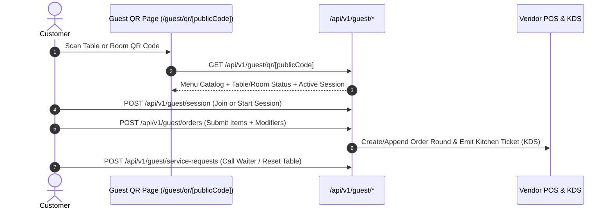

# 📱 Tier 3: Customer / Guest (QR Self-Ordering) Developer Guide

The **Customer / Guest** tier powers contactless QR self-ordering for dining tables, cabins, and hotel rooms without requiring a staff login.

---

## 1. Where the Code Lives

| Layer | Path | Purpose |
| :--- | :--- | :--- |
| **Guest App (UI)** | `frontend/src/app/guest/qr/[publicCode]/page.tsx` | Mobile-first QR storefront: catalog browsing, modifiers, shared table cart, order status tracking, bill view, and server turnover alerts |
| **Guest APIs** | `backend/src/app/api/v1/guest/qr/[publicCode]/route.ts` | Resolve QR public code to business, branch, table/room, active session, and menu |
| | `backend/src/app/api/v1/guest/session/route.ts` | Create or join an active table/room guest session |
| | `backend/src/app/api/v1/guest/verify/route.ts` | Guest verification / OTP / table-code check |
| | `backend/src/app/api/v1/guest/orders/route.ts` | Submit guest self-order rounds into the POS & KDS pipeline |
| | `backend/src/app/api/v1/guest/service-requests/route.ts` | Send waiter call, bill request, or "Previous guests left / Reset Table" turnover alert |

---

## 2. Customer QR Ordering Flow

---

## 3. Security Guardrails
- `publicCode` is an opaque, rotatable token (`qr-locations/[id]/rotate`), never a raw internal table/room primary key.
- Guest endpoints only expose menu items, session totals, and order statuses belonging to the resolved `qrLocation` — guests cannot read other tables, tenant financials, or staff endpoints.
- Staff can rotate QR codes at any time from **Restaurant → Generate Menu QR** or **Hotel → Guest QR Portal** if a code is misused.
