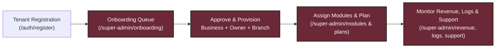

# 👑 Tier 1: Super Admin Developer Guide (`SUPER_ADMIN`)

The **Super Admin** tier governs the multi-tenant SaaS platform. Super Admins do **not** operate individual restaurant counters or hotel front desks; they onboard tenants, manage subscription plans, enable/disable feature modules, monitor platform health, and handle support/audit logs.

---

## 1. Where the Code Lives

| Layer | Path | Purpose |
| :--- | :--- | :--- |
| **App Routes (UI)** | `frontend/src/app/dashboard/super-admin/` | Dashboard, Businesses (`[id]`, `pending`, `expiring`), Onboarding, Modules, Subscriptions & Plans, Revenue, Activity Logs, Monitoring, Notices, Support, Users, Settings |
| **Feature Modules** | `frontend/src/features/super-admin/` | Reusable drawers/modals (`BusinessInspectionDrawer.tsx`, `BusinessModal.tsx`) |
| **Backend APIs** | `backend/src/app/api/v1/super-admin/` | Platform-only REST endpoints guarded for `SUPER_ADMIN` |
| **Navigation Rules** | `frontend/src/lib/nav-config.ts` | Sidebar sections filtered to `roles: ["SUPER_ADMIN"]` |

---

## 2. Core Super Admin Workflows

### Key Responsibilities
1. **Onboarding & Business Lifecycle:** Approve/reject pending business registrations, inspect business profiles, suspend/reactivate accounts, or extend expiring subscriptions.
2. **Module Entitlements:** Toggle tenant access to Restaurant POS, Hotel PMS, Inventory, Accounting, and Guest QR modules.
3. **Platform Telemetry:** Review cross-tenant activity logs, system health, broadcast notices, and support tickets.

---

## 3. Security Guardrails
- Every endpoint under `backend/src/app/api/v1/super-admin/*` must validate `session.user.role === "SUPER_ADMIN"` via `requireRole(req, ["SUPER_ADMIN"])` in `backend/src/lib/api-helper.ts`.
- Never allow tenant-scoped roles (`OWNER`, `MANAGER`, `CASHIER`) to access `/api/v1/super-admin/*` or `/dashboard/super-admin/*`.
