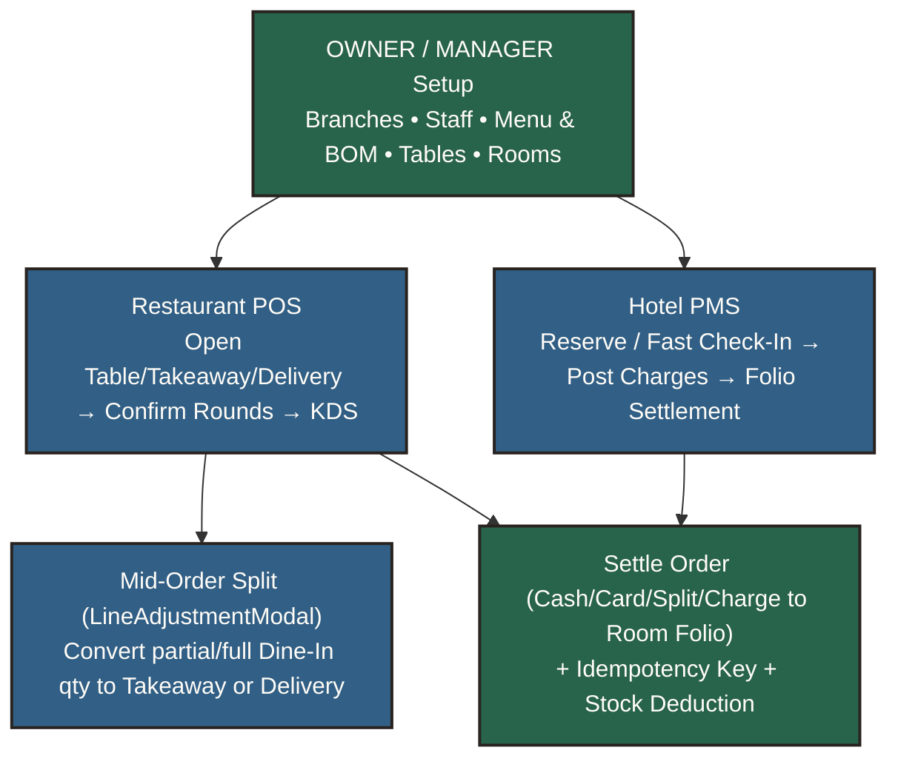

# 🏨 Tier 2: Vendor (Business Admin & Staff) Developer Guide

The **Vendor** tier covers all tenant-level operations inside a registered business and its branches. It includes **Vendor Admins** (`OWNER`, `MANAGER`) and **Branch Staff** (`CASHIER`).

---

## 1. Sub-Roles Inside a Vendor Business

| Role | Scope | Key Permissions |
| :--- | :--- | :--- |
| **`OWNER`** | Entire Business (All Branches) | Full business & branch management, staff creation, subscription billing, financial/IRD settings, all operational actions |
| **`MANAGER`** | Assigned Branch(es) | Menu & room setup, inventory adjustments/transfers, order/line cancellations, payment reversals, reports, POS & PMS |
| **`CASHIER`** | Assigned Branch & Shift | Restaurant POS, KDS status updates, Hotel check-in/out & folio charges, retail sales, shift open/close, payment collection |

---

## 2. Where the Code Lives

### Frontend (`frontend/src/`)
| Domain | App Pages (`app/dashboard/`) | Feature Module (`features/`) |
| :--- | :--- | :--- |
| **Restaurant POS & KDS** | `restaurant/pos/`, `restaurant/kds/`, `restaurant/tables/`, `restaurant/menu/`, `restaurant/qr/`, `restaurant/reports/` | `features/restaurant/` *(POS Cart/Tickets/KDS Zustand stores, `LineAdjustmentModal`, `CancelOrderModal`, `SettlementModal`)* |
| **Hotel PMS & Folios** | `hotel/rooms/`, `hotel/reservations/`, `hotel/stays/`, `hotel/folios/`, `hotel/housekeeping/`, `hotel/qr-portal/`, `hotel/pilot-ops/` | `features/hotel/` *(Rooms, Tape Chart, Folios, Check-in/out, Extend/Transfer Stay)* |
| **Inventory & Products** | `products/`, `categories/`, `inventory/` (`current-stock`, `stock-movements`, `stock-adjustments`, `batch-stock`, `damage-expiry`, `stock-value`, `movement-history`, `opening`, `transfers`) | `features/products/`, `features/inventory/` *(Catalog, Recipe BOM, Stock Transfers, Batch Tracking)* |
| **Retail POS & Shifts** | `pos/`, `sales/`, `shifts/` | `components/` + shared POS/register hooks |
| **CRM & Financials** | `customers/`, `suppliers/`, `expenses/`, `purchases/`, `payments/`, `reports/` | `features/crm/`, `features/financials/`, `features/reports/` |
| **Branch & Staff Admin** | `branches/`, `users/`, `settings/`, `subscriptions/` | `features/settings/`, `features/users/` |

### Backend (`backend/src/app/api/v1/`)
- `restaurant/*` — Floors, spaces/tables, menus, sections, items, modifiers, recipes, sessions, orders, rounds, mid-order line fulfillment adjustments, cancellations, KDS tickets, reports.
- `hotel/*` — Floors, room types, rooms, availability, tape-chart, reservations, stays (check-in/out/extend/transfer), folios (charges, reversals, transfers, settlement), housekeeping, maintenance, night audit, QR locations.
- `inventory/*`, `products/*`, `categories/*`, `subcategories/*`, `units/*` — Stock levels, adjustments, transfers, opening stock, damage/expiry, Recipe BOMs.
- `sales/*`, `purchases/*`, `payments/*`, `expenses/*`, `credit-notes/*`, `debit-notes/*`, `registers/*`, `shifts/*`, `compliance/*`, `reports/*` — Billing, registers, accounting, and IRD compliance.

---

## 3. Key Vendor Workflows

---

## 4. Security & Multi-Tenant Isolation Rules
- Every Vendor query and mutation **must** scope by `businessId` (and `branchId` where branch-bound) derived from the authenticated session — never trust a raw `businessId` from the request body alone.
- All financial/stock mutations use `x-idempotency-key` via `frontend/src/lib/idempotent-request.ts` and `backend/src/lib/idempotency.ts`.
